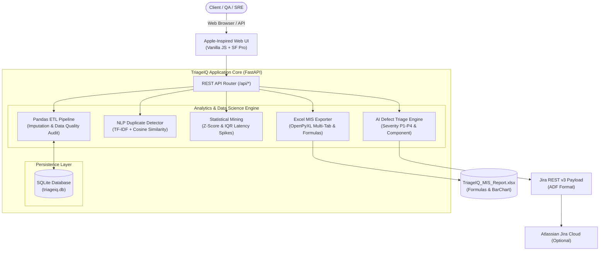

# TriageIQ — AI-Powered Defect, Ticket & Operational Data Triage Hub

[](https://github.com/company/triageiq/actions/workflows/ci.yml)
[](https://www.python.org/downloads/)
[](https://fastapi.tiangolo.com)
[](LICENSE)

> **TriageIQ** is a lightweight, production-grade defect triage, anomaly detection, and operational MIS intelligence engine. Built with an **Apple.in-inspired minimalist UI**, it automates software support incident classification, detects semantic duplicate tickets with NLP TF-IDF, discovers statistical latency anomalies using Z-scores & IQR, synchronizes structured Jira Cloud REST API v3 payloads, and generates executive multi-tab Excel MIS reports with formulas and embedded charts.

---

## 🎯 Executive Highlights & Key Capabilities

| Capability | Engine & Tech Stack | Description |
| :--- | :--- | :--- |
| **AI Defect Triaging** | NLP Heuristics + Rule Matrix | Classifies incoming customer complaints/stack traces into **Severity (P1–P4)** and **Component (API, UI, Database, Payments, Auth)** within milliseconds. |
| **Duplicate Ticket Detector** | `scikit-learn` TF-IDF + Cosine Similarity | Vectorizes bug reports and uncovers semantic duplicates (e.g. matching *"Stripe checkout 500"* against *"Payment charge API timeout"*). |
| **Statistical Anomaly Mining** | Pandas + SciPy Statistical Engine | Calculates **Z-score ($\ge 2.0\sigma$)** and **IQR upper bounds** on response latency, exposing database lockups and API latency spikes. |
| **Jira REST API v3 Sync** | Official Atlassian Document Format (ADF) | Generates valid Jira REST API v3 bug issue JSON with structured steps to reproduce, root cause hypothesis, and supports live Jira Cloud push. |
| **Styled Excel MIS Export** | `openpyxl` Multi-Tab Generator | Downloads formatted `.xlsx` workbooks containing Executive Summary KPI cards, Excel formulas (`COUNTIF`, `AVERAGE`), conditional severity fills, and an embedded native Bar Chart. |
| **ETL Data Cleaning Pipeline** | Pandas Ingestion Engine | Cleans messy Excel/CSV uploads: imputes missing categories & median latencies, flags malformed records, and computes a **Data Quality Score %**. |
| **Minimalist Apple.in UI** | SF Pro Typography & Vanilla JS | Ultra-clean light-mode interface (`#fbfbfd`, `22px` border-radius elevated cards, `#0071e3` pill buttons, frosted glass header). |

---

## 🏛️ System Architecture



---

## 📁 Repository Structure

```text
TriageIQ/
├── app/
│   ├── __init__.py
│   ├── database.py       # SQLite engine, 25 messy seed incidents, CRUD & Jira board
│   ├── analytics.py      # ETL pipeline, TF-IDF deduplication, Z-score/IQR anomaly detector,
│   │                     # AI triage & Atlassian Jira v3 generator, openpyxl MIS exporter
│   └── main.py           # FastAPI endpoints, CORS, static mounting, test runner
├── static/
│   ├── index.html        # Apple.in-inspired minimalist UI layout
│   ├── style.css         # SF Pro typography, #0071e3 accents, frosted sticky header
│   └── app.js            # Reactive client controller & interactive Kanban board
├── tests/
│   └── test_triageiq.py  # Comprehensive pytest test suite (ETL, TF-IDF, Jira, Excel, API)
├── sample_data/
│   ├── sample_incidents.csv   # Messy raw dataset for ingestion testing
│   └── sample_incidents.xlsx  # Multi-column Excel test file
├── .github/workflows/
│   └── ci.yml            # Automated GitHub Actions continuous integration pipeline
├── requirements.txt      # Lightweight production dependencies
└── README.md             # Recruiter-ready technical documentation
```

---

## 🚀 Quickstart Guide

### 1. Prerequisites
- Python 3.9+ (tested on Python 3.9, 3.10, 3.11, 3.12)

### 2. Clone & Setup Virtual Environment
```bash
git clone https://github.com/company/triageiq.git
cd TriageIQ

# Create local virtual environment
python3 -m venv .venv
source .venv/bin/activate

# Install dependencies
pip install -r requirements.txt
```

### 3. Run the Server
```bash
uvicorn app.main:app --reload --port 8000
```
Open your browser and navigate to: **[http://localhost:8000](http://localhost:8000)**

---

## 🧪 Automated Testing

TriageIQ includes a comprehensive suite of automated tests verifying the entire data pipeline:
- **ETL Cleaning & Normalization**: Imputation of missing components/severities, median latency substitution, and malformed row filtering.
- **TF-IDF & Cosine Deduplication**: Accurate clustering of semantically identical incident descriptions.
- **Statistical Anomaly Surfacing**: Outlier verification through Z-score $>2.0\sigma$ and IQR thresholding.
- **Atlassian Jira REST API v3 ADF Validation**: Document structure conforming to Jira Cloud standards.
- **OpenPyXL Multi-Tab Excel Verification**: Cell-level validation of formulas (`COUNTIF`, `AVERAGE`), sheet integrity, and embedded charts.

To run the tests:
```bash
pytest -v
```

> 💡 **In-Browser Verification**: You can also click the **"Run pytest Suite"** button in the top navigation bar to execute the test suite programmatically from the UI and view the live terminal log.

---

## 📊 Styled Microsoft Excel MIS Report

The `GET /api/export/excel` endpoint generates an executive-ready multi-tab `.xlsx` workbook crafted with `openpyxl`:

1. **`Executive_Summary` Tab**:
   - Dark slate banner `#1E293B` with high-contrast typography.
   - Dynamic Excel summary formulas:
     - `=COUNTA(Cleaned_Tickets_Data!A2:A26)`
     - `=COUNTIF(Cleaned_Tickets_Data!D2:D26, "P1")`
     - `=AVERAGE(Cleaned_Tickets_Data!E2:E26)`
     - `=SUM(Cleaned_Tickets_Data!I2:I26)`
   - **Embedded Native Bar Chart**: Visualizing defect volume across P1, P2, P3, and P4 severity tiers.

2. **`SLA_and_Anomalies` Tab**:
   - Filtered view of breached SLAs and latency spikes with deep-red headers and highlighted rows.

3. **`Cleaned_Tickets_Data` Tab**:
   - Complete cleansed operational dataset with dark slate headers, zebra striping (`#F8FAFC` vs `#FFFFFF`), and conditional severity color badges (P1 Red, P2 Orange, P3 Yellow, P4 Green).

---

## 🔌 Jira Cloud REST API v3 Integration

TriageIQ produces Jira v3 payloads in Atlassian Document Format (ADF):
```json
{
  "fields": {
    "project": { "key": "TIQ" },
    "summary": "[Payments] Stripe checkout fails with HTTP 500 error",
    "issuetype": { "name": "Bug" },
    "priority": { "name": "Highest" },
    "labels": ["triageiq-ai", "payments", "p1"],
    "description": {
      "type": "doc",
      "version": 1,
      "content": [
        {
          "type": "paragraph",
          "content": [{ "type": "text", "text": "Generated by TriageIQ AI Defect Triage Engine." }]
        }
      ]
    }
  }
}
```
Optional live push to Atlassian Jira Cloud is supported via `POST /api/jira/sync` when `jira_cloud_url`, `jira_email`, and `jira_api_token` are provided.

---

## 🛠️ Tech Stack & Minimal Disk Footprint

- **Backend Web Framework**: FastAPI 0.128 & Starlette
- **Data Engineering**: Pandas 2.3 & NumPy 2.0
- **Machine Learning & NLP**: Scikit-Learn 1.6 (TfidfVectorizer & Cosine Similarity)
- **Spreadsheet Generation**: OpenPyXL 3.1
- **Testing**: Pytest 8.4 & HTTPX 0.28
- **UI / Frontend**: Apple-inspired Vanilla JavaScript, SF Pro System Typography, CSS3 Grid/Flexbox
- **Storage**: SQLite 3 (zero-configuration embedded engine)

---

## 👤 Author & Recruiter Reference

Developed as a showcase of **AI-driven QA engineering, Data Science ETL pipelines, and high-standard enterprise software design**.
